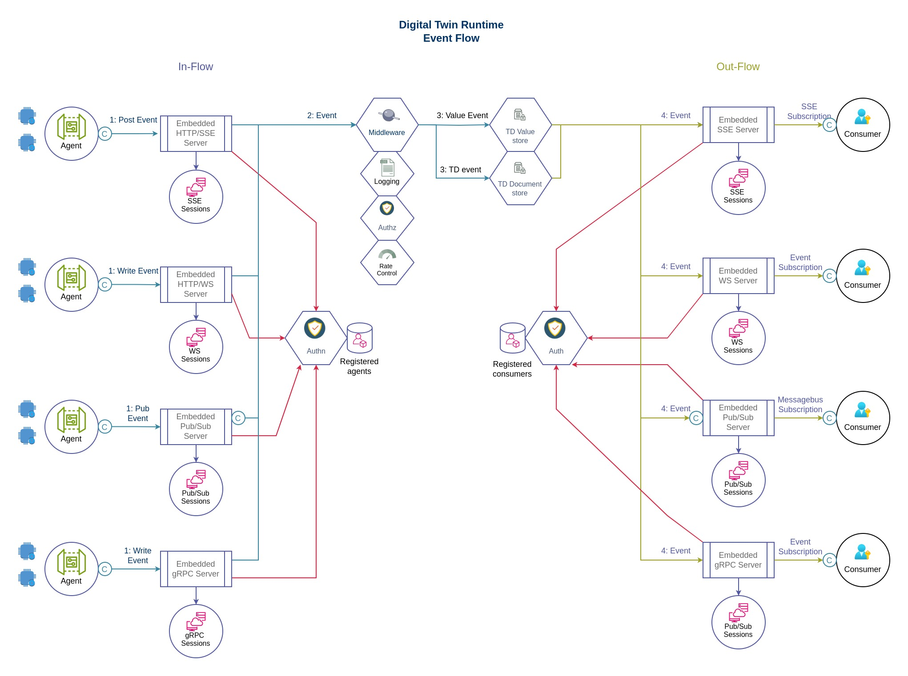
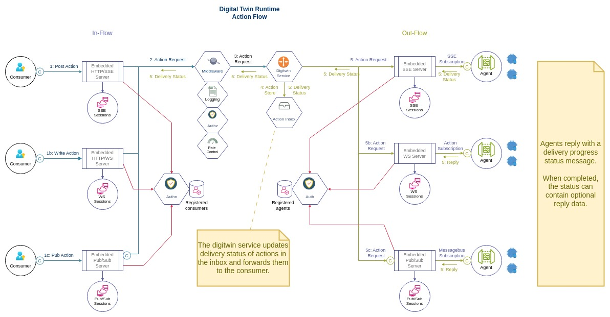

# HiveOT Hub Runtime 

## Status 

The Hub runtime is being reworked to use HiveKit.

## Summary

The Hub runtime provides routing of events and actions between devices, services and consumers using one or multiple transport protocols. The runtime serves digital twins of IoT devices to consumers, containing the device Thing Definition and state. 

The runtime includes services for messaging, authentication and authorization and managing digital twin instances of IoT devices and services. It contains:
* Transport servers for communication with devices, services and consumers
* Authentication service authenticates connections to the transport protocols
* Authorization service for authorizing the sending and receiving of messages by authenticated clients
* Router for routing requests from consumers to devices and services and notifications from devices to consumers
* Digitwin directory serves a digital twin of the inventory of available devices

The digital twin part of the runtime is designed using the W3C WoT standards and
handles Thing Description Documents, events, actions and properties.

### Events
Event messages follow a publish/subscribe approach. Devices and services publish notifications with events while consumers subscribe to Thing events. Each can use their preferred transport protocol.

The general event flow is:
> thing -> transport client -> digital twin
>   digital twin -> transport server -> subscribers

Events delivered by Things are stored in its digital twin. The twin retains events until they expire which can vary between immediately to years. 

Consumers can request the latest event and property values of a Thing from the digital twin.

### Actions
Actions are messages targeted at a specific Thing or service. Consumers publish action requests while devices receive these requests. Each can use their own protocol binding.

The general action delivery flow is:
> consumer -> transport client -> digital twin
>   digital twin -> router -> transport server -> RC-device -> Thing
>                          -> transport client -> device server -> thing

Devices send a status update when actions are applied and completed:
> Thing -> transport client -> transport server -> digital twin 
>   digital twin -> transport server -> consumer

Action requests are delivered by the transport protocol to the digital twin inbox for the targeted Thing. Action requests always return with a delivery status containing the delivery progress and possibly a reply value. The action flow can hold one of the following delivery status values: 
* pending   - the action is received by the hub, placed in the outbox, but not yet delivered to the thing agent 
* delivered - the action request is delivered to the Thing agent but not yet applied
* waiting   - the action is waiting to be applied by the agent, eg device is asleep or offline
* applied   - the action was applied but result is waiting for confirmation
* completed - the action was applied and result is available
* failed    - unable to deliver the action to the agent or Thing

The action request goes through two flows, the delivery flow and the return flow:
Steps of the delivery flow:
1. Consumer sends an action request via its transport protocol.
2. The transport protocol passes it to the digitwin inbox.
3a. If the agent is reachable, the request is forwarded to the protocol binding that delivers it to the agent. The request returns with the status 'delivered'.
3b. If the agent is not reachable, the request returns with the status 'pending'.
4. When an agent connects then the inbox is notified who passes pending requests to the agent and updates the delivery status to 'delivered'.

Steps of the return flow:
1. When the action for a Thing is applied and immediate feedback is received, the status message 'completed' is sent to the digital twin inbox, containing the result value if applicable. 
2. If the action is applied by the agent and no immediate feedback is received then the delivery status message 'applied' is sent by the agent to the digital twin inbox.
3. If apply the action to the Thing fails, then a delivery status message completed is sent  by the agent to the digital twin inbox, containing the error message. This is a considered a successful delivery. Unfortunately it didn't work, hence the error.
4. If the action cannot be applied because the Thing is offline or sleeping then the delivery status 'waiting' is sent with a reason code of 'sleeping' or 'offline'.
   4a. If waiting is not supported by the agent then the agent can send a failed status update and the consumer will have to send a new request.
   4b. If the action expires before being applied then the agent drops the action and sends the failed status update with an error message describing it has expired.
   4c. Once the Thing is reachable, the action is applied then this goes to step 2. 

Applying an action can result in a state change in the device. In this case the status change event is sent separately by the agent as described in the events section of the Thing's TDD.

When the digital twin inbox receives a status update from the agent, it is passed to the consumer that sent the request, if it is online. If the consumer is offline then the status update is not repeated. On connecting the consumer can obtain the latest values from the outbox.

## Transport Protocols

The runtime operations multiple transport protocols provided by HiveKit, including http-basic, WoT websockets, HiveOT gRPC, and (once completed) WoT MQTT.

If a connection based return channel is available, for example using SSE with HTTPS then the client's 'connected status' is based on the return channel. For example, the HTTPS protocol binding uses SSE as a return channel. SSE sessions are used to determine if the client is connected.

If a transport protocol does not support a return channel then it can fall back to polling on a prescribed interval. If polling doesn't take place within the interval, the connection is deemed lost. Some queuing is needed in this case to bridge the time between polling. This is specific to the protocol binding. 
  

## Built-in Services

The runtime uses the digitwin recipe which includes essential built-in services to support the digital twin:
1. Transport servers (see previous paragraph).
2. Authentication (authn) services. Intended for use by transport protocols to authenticate and verify a client's identity. 
2. Authorization (authz) service. Intended for use by transport protocols to verify the ability of clients to publish or subscribe to certain agents, depending on the client's role.
3. Certificate management for creating server certificate.
4. Logging service for logging of requests and responses.
5. History service for tracking select requests and notifications.
6. Directory service for serving TD's from digital twins, RC devices and TDs uploaded by an administrator.
7. Discovery service for serving the discovery process of the directory TDD.
8. Router service for routing requests to RC devices and stand-alone devices.
9. Digital Twin service.

---

## Q & A

1. When to use events vs properties? 
    This recommendation is based on the following assertions:
    * Properties are used to report persistent internal device state.
        * Configurations are writable properties.
        * Immutable information are read-only properties.
        * Sensor status are read-only properties
        * Actuator status are read-only properties (control with actions)
    * Non-permanent or external state changes are reported with events
        * motion detection
        * doorbell button (and other push buttons)
        * actuator state changes are reported with events
        * sensor state changes are reported with events (the state is external)
    * Events can have related read-only properties to reflect the last known value. For example, the alarm state of a motion sensor could be presented with a property which the state change is an event.
    * The final decision is of course up to the Thing developer.

2. When to use actions vs properties?
    This recommendation is based on the following assertions:
    * Actions are operations used to control a device.
      * For example, controlling a light dimmer, blinds, water valves.
      * Service requests are actions. 
        * For example, adding a user account.
        * Service requests typically involves one or more input parameters and only actions can provide multiple inputs per request. It would be non-intuitive to change action vs property based on the number of input parameters.
      * Stateless device operations are always actions. Since there is no state, there is no property that reflects the state.
      * Action progress for long running actions can be reported through a (read-only) property or an event. For example, progress in opening blinds.
      * If it requires multiple input parameters then it is an action.
    * Properties reflect status or control configuration.
      * Properties must be idempotent. Setting a value always has the same outcome that is reflected by that property.

3. How is action state stored in properties by digitwin?
   The state affected by actions are available through properties.
    * Option 1: as a single object property with nested properties for each value. Property name is the action name (just a convention)
    * Option 2: as individual properties. The action output is an object containing each affected property. (also just a convention)

4. How to track the action progress for long running actions?
   Since WoT doesn't specify tracking progress on long running actions, the recommended approach is that actions are always instant, eg they complete immediately. State changes after the action are presented through events or properties.
    * An action returns immediately as either completed or failed. The status reflects the successful start of the action, not its completion. If an action takes time to complete then an event can be used to report the final result.
    * To open blinds, the action to open is completed once the blinds start opening. A property can indicate how for blinds are opened and an event can be posted when the blinds are fully opened. 
    * Similarly, when setting a dimmer with delay, the action is completed when the requested outcome is set. The dimmer will use the delay to slowly change its state, which can be obtained through a property. Once the dimming set value is reached an event is posted indicating the dimmer has reached the set value.
    * To link intermediate state changes with the action that initiated it, the correlation ID of the request can be included in the property or event notification.

5. How to track property write progress?
    * Property write operations return an immediate response just like actions.
    * In protocols that don't support acknowledgement, hiveot assumes completion on return.
    * After a property write, a property update notification indicates the actual property value. Callers can of course also send an action to read the property value.

6. How to integrate devices with the Hub
    * Devices connect to the hub, just like consumers.
    * Devices serve requests and return responses independent from how they are connected. RC devices connect to the Hub use reverse-connection and handle requests send to them over this connection.

